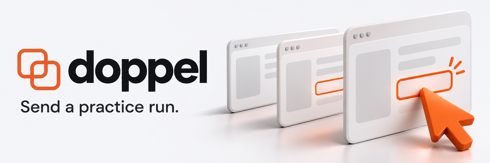
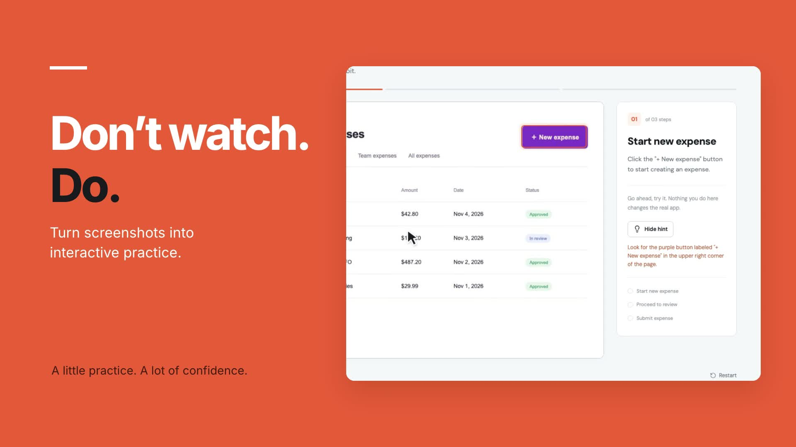
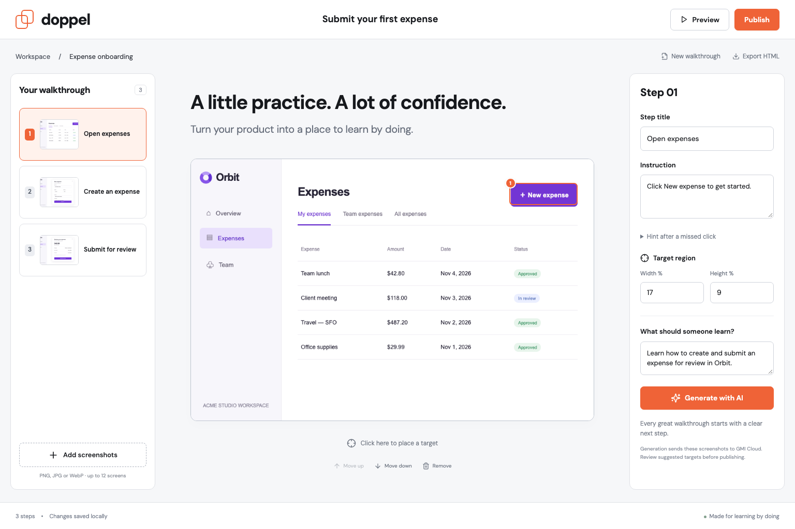
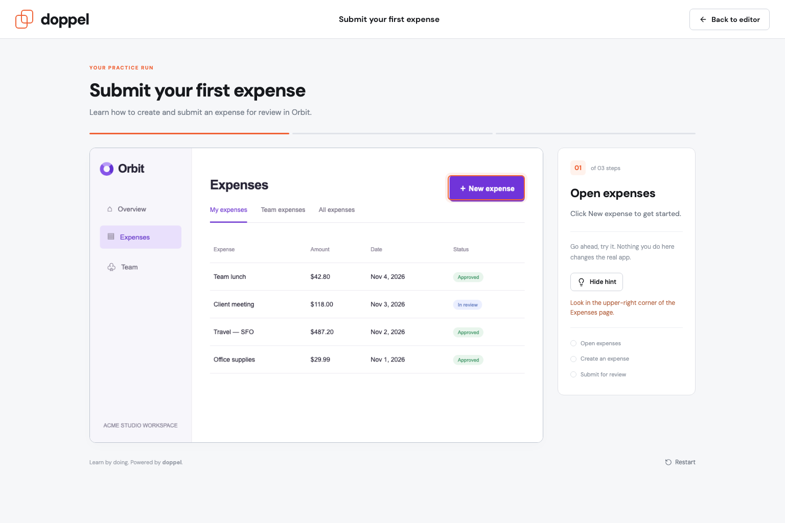
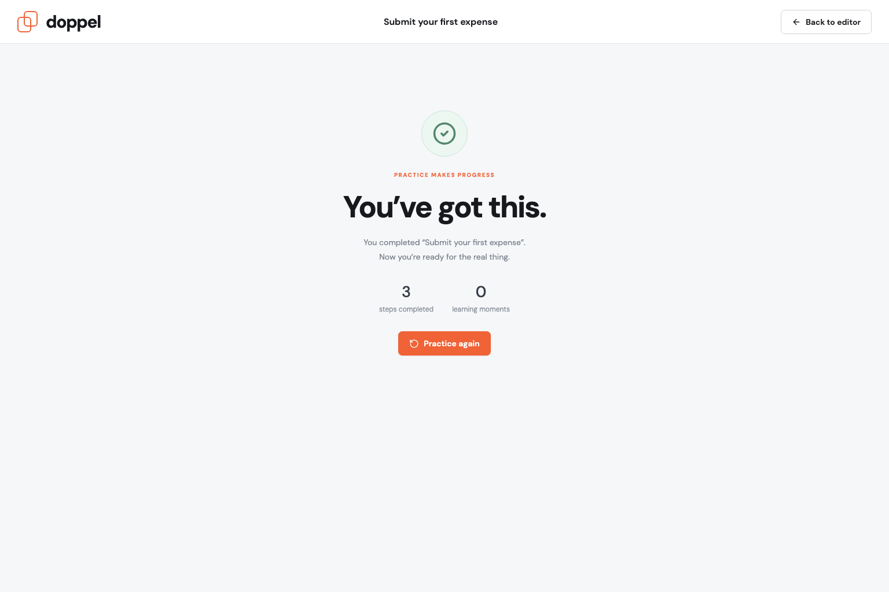
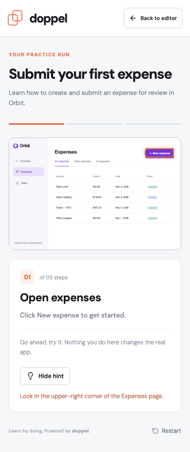
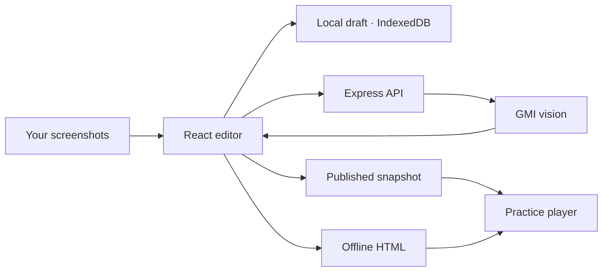

<p align="center">
  
</p>

<p align="center">
  <strong>Turn product screenshots into interactive lessons people can actually practice.</strong>
</p>

<p align="center">
  <a href="https://github.com/coldrazer/doppel/actions/workflows/ci.yml"></a>
  <a href="LICENSE"></a>
  
  
</p>

<p align="center">
  <a href="#watch-it-work">Watch the demo</a> ·
  <a href="#quick-start">Quick start</a> ·
  <a href="#inside-doppel">Screenshots</a> ·
  <a href="docs/DEVELOPMENT.md">Developer guide</a>
</p>

---

Watching someone use an app is different from knowing how to use it. Doppel gives your teammates, customers, and new users a safe place to try a workflow themselves.

**Upload a few screenshots → describe the goal → review the AI’s suggestions → share a playable lesson.**

A missed click becomes a useful hint. A correct click advances the lesson. Nothing touches the real application.

## Watch it work

[](https://github.com/coldrazer/doppel/blob/main/docs/demo/doppel-demo.mp4)

**[▶ Watch the 60-second demo](https://github.com/coldrazer/doppel/blob/main/docs/demo/doppel-demo.mp4)** · [Download MP4](https://raw.githubusercontent.com/coldrazer/doppel/main/docs/demo/doppel-demo.mp4)

Real app footage, an electronic soundtrack, and the full journey from screenshots to a completed practice run. No voiceover. [Music credit and production notes](docs/demo/README.md).

## What you can build

| Capability | What it does |
| --- | --- |
| **Screenshot-to-lesson creation** | Upload up to 12 PNG, JPG, or WebP screens in workflow order. |
| **AI-assisted authoring** | GMI vision suggests a title, instruction, hint, and clickable target for each screen. |
| **Precise manual control** | Reposition and resize targets, rewrite instructions, and reorder steps. |
| **Guided practice** | Learners get corrective hints, a checklist, progress, and a completion screen. |
| **Shareable snapshots** | Publish an immutable lesson; later draft edits leave that version intact. |
| **Offline HTML export** | Download one self-contained file with its screenshots and player included. |
| **Local draft persistence** | Continue editing after a reload; drafts stay in the browser’s IndexedDB. |

## Inside Doppel

### The creator workspace

A screenshot canvas, a clear step sequence, and an inspector for the next action. Start with the included Orbit expense example or bring your own screens.



### The learner experience

A safe, clickable simulation. A hint points learners toward the right action without skipping the step.



<details>
<summary><strong>See completion and mobile views</strong></summary>



<p align="center"></p>

</details>

## Quick start

**Requires Node.js 22.12+; Node 24 is recommended.**

```bash
git clone https://github.com/coldrazer/doppel.git
cd doppel
npm ci
cp .env.example .env.local
npm run dev
```

Open **[localhost:5173](http://localhost:5173)**. The sample walkthrough is ready to play immediately.

To enable AI authoring, set `GMI_API_KEY` in `.env.local` using a credential from [GMI Cloud](https://console.gmicloud.ai/). The key stays on the server. Manual authoring, playback, publication, and HTML export work without an AI credential.

<details>
<summary>Configuration</summary>

| Variable | Default | Purpose |
| --- | --- | --- |
| `GMI_API_KEY` | Unset | Enables the server-side GMI vision call. |
| `GMI_MODEL` | `google/gemini-3.8-flash` | Vision model used to suggest actions and targets. |
| `HOST` | `127.0.0.1` | Server bind address. |
| `PORT` | `5173` | HTTP port. |

The server reads `.env.local` automatically. Screenshots are sent to GMI only when **Generate with AI** is selected. Review suggested targets before publishing.

</details>

### Create your first lesson

1. Choose **New walkthrough**, then upload screenshots in the order someone should follow.
2. Enter a title and a learning goal. Use **Generate with AI**, or write the steps yourself.
3. Review every screen. Reposition the target and adjust its dimensions, instruction, and hint.
4. Select **Preview** and complete the practice run.
5. **Publish** a snapshot, or **Export HTML** to share a standalone file.

> **Sharing:** a `localhost` learner link works on the machine running the server. Use the HTML export to share without hosting. Published links require the corresponding server and its `data/` directory to remain available.

## Built to be inspectable



React + Vite power the editor and player. Express handles the GMI proxy and publication storage. Zod validates screenshots and normalized target bounds. The API credential is never bundled into the client or exported lessons.

## Development & verification

```bash
npm test             # schema and validation tests
npm run build        # production client build
npm start            # serve the production build
npm run test:e2e      # Playwright journeys; app must be running
```

CI runs the build, **4 schema tests**, and **6 browser journeys**. Browser tests cover creation, saved drafts, publishing, learner hints and completion, offline export, AI error handling, and mobile layout. A separate live GMI generation-to-publication journey was also verified locally.

[Developer guide](docs/DEVELOPMENT.md) · [QA evidence](docs/QA.md) · [Contributing](CONTRIBUTING.md)

## Current scope

Doppel is a working **single-user MVP**, built for the Ship Happens hackathon. It simulates clicks on screenshots; it does not clone application backends or support real text-entry tasks. Completion timestamps are local to the learner’s browser, not team analytics.

Public multi-tenant hosting needs authentication, authorization, quotas, HTTPS, and durable storage. The included server is intentionally local by default.

Hackathon submission also requires Wren test results. [Two acceptance journeys](docs/WREN.md) are prepared; Wren has not been run in this environment.

## License & credits

Application code is licensed under [Apache 2.0](LICENSE). The repository banner is AI-generated; product screenshots and demo footage come from the working app. The demo’s music has its own [CC BY 4.0 attribution](docs/demo/README.md).

<p align="center"><strong>A little practice. A lot of confidence.</strong></p>
